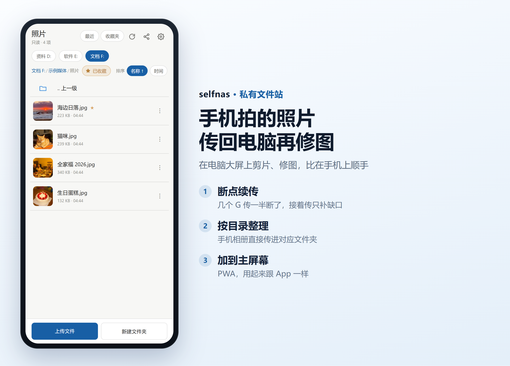
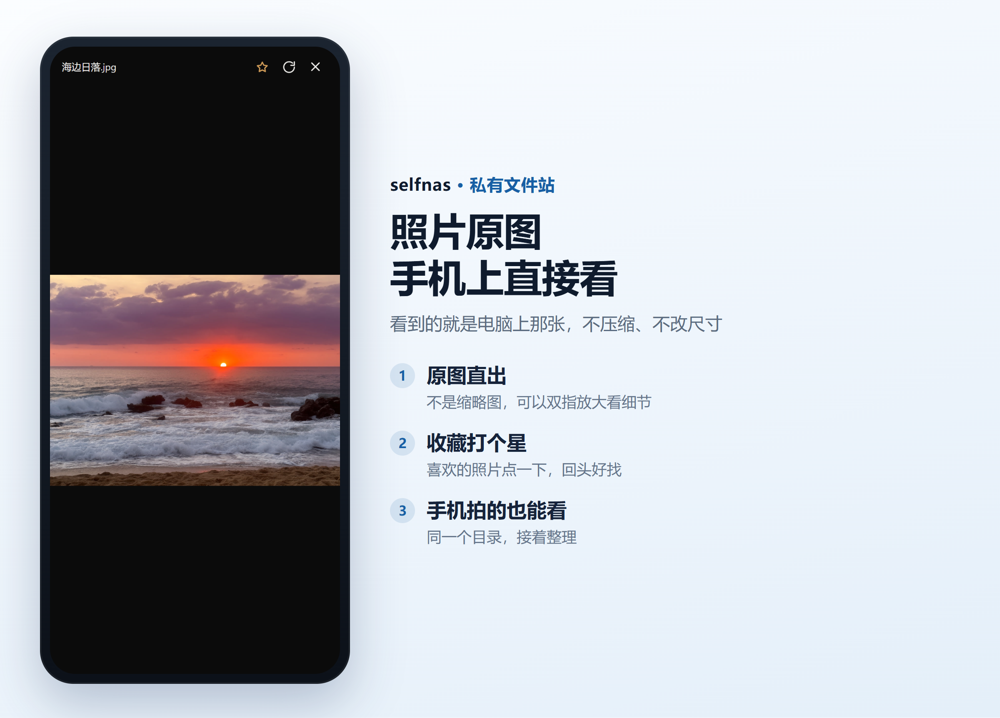
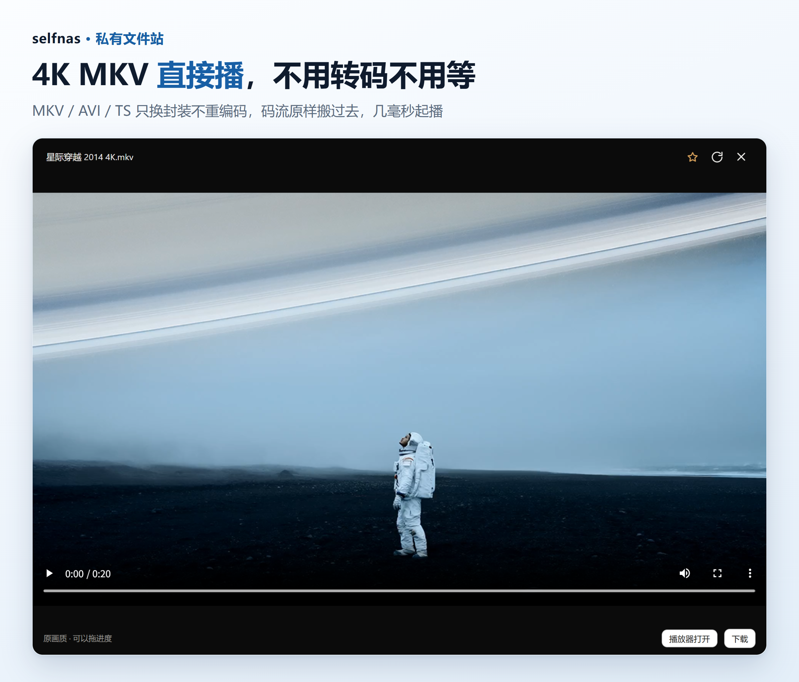
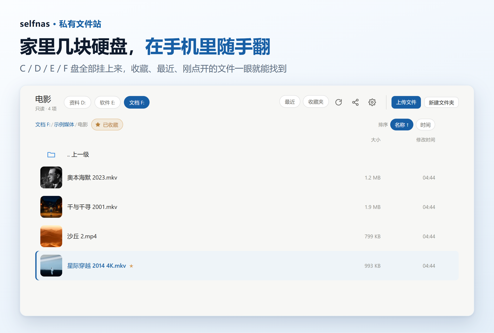
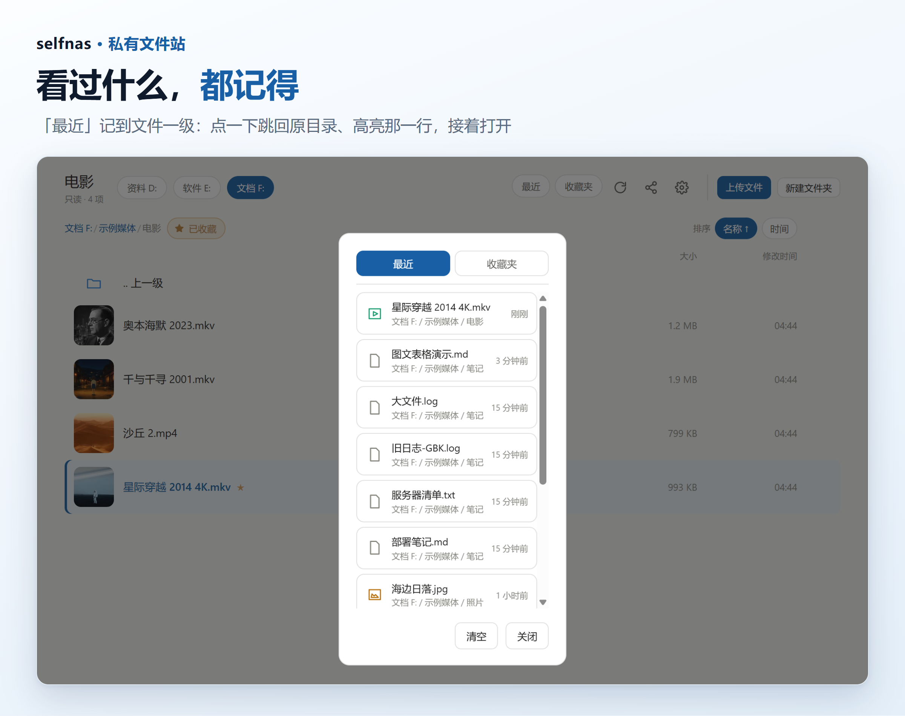
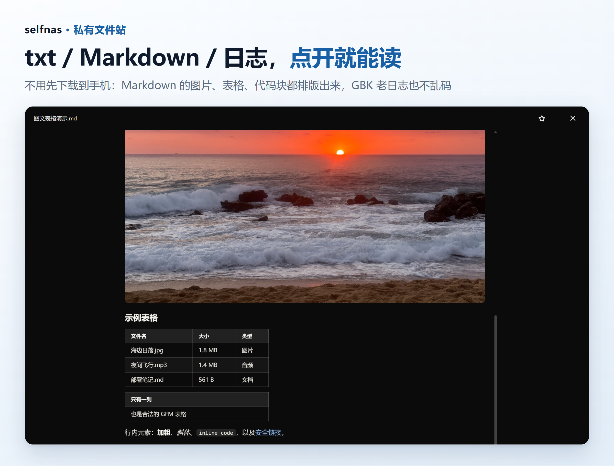
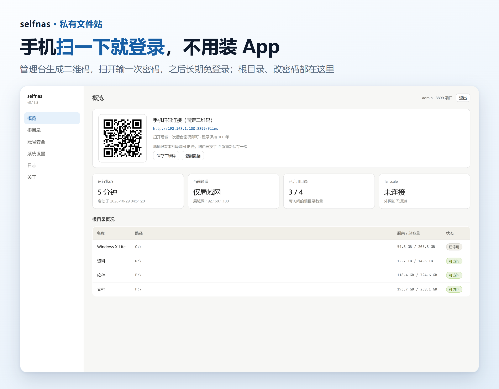

# selfnas

**把一台电脑变成你自己的文件中心。** 单个 Go 二进制、无 cgo、无外部依赖（SQLite 用纯 Go 实现）；手机扫码即用，不用装 App。

数据全部留在自己手里，不经过任何网盘、任何第三方服务器。


<table>
<tr>
<td width="25%" align="center"><b>手机看片</b><br><sub>4K MKV 不转码，点开秒播</sub></td>
<td width="25%" align="center"><b>照片回传</b><br><sub>断了接着传，只补缺口</sub></td>
<td width="25%" align="center"><b>随手翻盘</b><br><sub>几块硬盘，一个入口</sub></td>
<td width="25%" align="center"><b>数据不出门</b><br><sub>没有云、没有账号体系</sub></td>
</tr>
</table>

## 它解决什么问题

家里那台常年开机的电脑，硬盘里存着几个 T 的电影、几万张照片、一堆资料。

- 想**躺床上用手机看**里面的电影 —— 拷到手机太麻烦，装一整套 Emby / Jellyfin 又太重，而且还常被 MKV 播不了卡住；
- **手机拍的照片和视频**想传回电脑，用大屏剪片、修图，比在手机上顺手得多；
- 有时候只是想在手机上**随手翻一下某个盘里的文件**，不想开远程桌面。

selfnas 就是干这三件事的：打开网页就能用，手机扫码就登录，不需要在手机上装任何东西。

---

## 界面

**手机上**（浏览器打开，也可以「添加到主屏幕」当 App 用）

<table>
<tr>
<td width="50%"></td>
<td width="50%"></td>
</tr>
</table>

**电脑上**



<table>
<tr>
<td width="50%"></td>
<td width="50%"></td>
</tr>
</table>



<sub>同一个查看器里：Markdown 的图片、表格、代码块、引用都按排版显示（GitHub 风格的 README 也能直接读）；txt / 日志 / 配置按纯文本显示，GBK 老日志不乱码。</sub>



<sub>管理台里还有：根目录增删改（可标只读）、改密码、访问日志、缓存占用、一键重新扫描磁盘、检查更新。所有页面共用一套 CSS，跟随系统深浅色。</sub>

> 截图来自一份演示实例，目录和文件都是临时造的，不是谁的真实资料。

---

## 特性

> **【新增】= 本次更新加入的功能**

**播放**
- MKV / AVI / TS 这类 iOS Safari 播不了的容器，**不做转码，只换封装**：`-c:v copy` 把码流原样搬进 fragmented MP4，4K 也是几毫秒起播
- 播不了才降级转码（可选，需要 ffmpeg）
- 前台先问「能不能播 / 要不要换封装 / 只给下载」，不让人对着黑屏等
- **【新增】接着上次看**：播放进度按账号记在服务端 SQLite，重开视频自动跳到上次位置（看完或拖回开头则清除）
- **外部播放器**：视频/音频预览底部点**「播放器打开」**，生成一条**短期签名直链**（6 小时有效，签名绑定路径 + 大小 + 过期时间，密钥是配置里的 `secret`）——iPhone 上自动唤起 VLC，没装就复制链接，粘到 Infuse / VLC / nPlayer 的「打开 URL / 网络串流」即可

**手机**
- 管理台生成二维码，扫一下就把手机带到对的地址并完成登录（一次性 token，120 秒有效）
- 自带 PWA manifest，可以「添加到主屏幕」，用起来跟 App 差不多
- **【新增】** 一键生成**分享海报**：竖版推广图带 GitHub 二维码，保存后发给朋友，扫码直达项目（iPhone 上长按图片即可存到相册）

**文件**
- 浏览、上传、下载、删除、重命名、移动、新建文件夹
- 上传走并行分片 + **按区间记录的断点续传**——写入是乱序的，靠一张已完成区间表判断「收齐了没有」，中断重传只补缺口
- 路径解析强制限定在配置的根目录内，越界直接 403
- 视频/图片缩略图懒加载，几百张图的目录也不会把接口拖死；缩略图跟着文件内容走，同名文件被替换会自动刷新
- **【新增】文本文件在线预览**：txt / Markdown / 代码 / 日志 / 配置点开直接看，手机上查笔记、翻日志不用先下载；GBK 编码的老日志也不会乱码
  - **Markdown 是完整排版**：图片（相对路径、`F:\…` 绝对路径、外链都行）、表格、代码块、引用块都渲染出来——GitHub 风格的 README 存在盘里也能直接读；阅读宽度收在 880px，长文不糊脸
  - 只读不改——改文件还是回电脑上改更稳妥

**找得回去**
- 「最近」记录**文件级**浏览历史，点一下跳到所在目录、高亮那一行、然后打开它
- **【新增】刚点开的文件会一直标出来**：文件名换主题色 + 左侧色条，关掉播放器、刷新页面都还认得出刚才开的是哪个（按账号存服务端）
- 「收藏」支持文件和文件夹
- 两者都存服务端 SQLite，跟账号绑定 —— 换手机、换浏览器、清缓存都还在（早期版本存在 localStorage，本质只属于那台设备，已废弃）
- 表里**只存路径不存元信息**，读的时候现 `stat`：文件被删/改名，列表里直接标「已不在」，不留骗人的旧记录

**管理**
- 网页管理台：端口、根目录（增删改、可标只读）、改密码、看日志、看缓存占用
- **【新增】开机自启**：管理台里一个开关——开机后在后台把服务拉起来，不弹黑窗口、不用先登录桌面（Windows 计划任务）；exe 换了地方点一下开关就能纠正指向
- **【新增】检查更新**：点一下才去查 GitHub Releases（不偷偷联网），结果存下来，有新版本时「关于」按钮旁挂个红点
- **一键重新扫描磁盘**：新硬盘、新分区、双系统里另一个系统多出来的盘，点一下自动加进根目录；已有的条目（改名/只读/禁用）不会被覆盖
- 配置改动热生效，不用重启
- 管理台默认只允许本机访问

---

## 快速开始

### 直接下载

到 [**Releases**](https://github.com/sylvesterzhang/selfnas/releases) 拿对应平台的压缩包，解压就能跑，不用装 Go：

| 平台 | 文件后缀 |
|---|---|
| Windows（64 位） | `windows-amd64.zip` → 双击 `selfnas.exe` |
| Linux x86_64 | `linux-amd64.tar.gz` |
| Linux ARM64（树莓派等） | `linux-arm64.tar.gz` |
| macOS Intel | `darwin-amd64.tar.gz` |
| macOS Apple Silicon | `darwin-arm64.tar.gz` |

Linux / macOS 解压后先加执行权限：

```bash
chmod +x selfnas && ./selfnas
```

> macOS 首次运行可能提示「无法验证开发者」（二进制没做代码签名，个人项目签不起 99 美元的年费）：
> ```bash
> xattr -d com.apple.quarantine ./selfnas
> ```

每个包都带 `SHA256SUMS`，介意的话可以核对一下。

> **测试范围**：五个平台的包都会发布，但**只有 Windows 版经过实际测试**。Linux / macOS 版是交叉编译产物，没有跑过测试——大概率能用，不打包票。在这些平台上遇到任何问题，请直接到 [Issues](https://github.com/sylvesterzhang/selfnas/issues) 提一下，看到就会跟进。

### 自己编译

需要 Go 1.24+。**不需要 cgo、不需要 GCC**，`CGO_ENABLED=0` 直接交叉编译。

```bash
git clone https://github.com/sylvesterzhang/selfnas.git
cd selfnas
go build -o selfnas.exe .
```

Linux / macOS：

```bash
CGO_ENABLED=0 GOOS=linux GOARCH=amd64 go build -o selfnas .
```

要一次编出全部五个平台（Windows / Linux / macOS × amd64、arm64）并打包：

```bash
python scripts/build.py      # 只编 Windows 就 python scripts/build.py windows
python scripts/release.py    # 打成 zip / tar.gz + SHA256SUMS，产物在 dist/
```

版本号只写在 `main.go` 的 `const version` 一处，两个脚本都会去读它。

### 运行

```bash
./selfnas.exe
```

首次启动会**自动生成 `config.json`**，枚举本机磁盘作为根目录（C 盘默认关闭）。账号密码是固定的：

```
账号 admin    密码 123456
```

登录管理台后第一件事就是改掉它 —— 管理台里有「修改密码」区块，填原密码和新密码就行。

> 早先版本是随机生成密码打印在控制台，实践下来不好用：双击 exe 启动时控制台一闪就没了，密码等于没给，还得去翻日志。固定默认密码至少能让人进去。

启动横幅：

```
================================================
  selfnas 0.19.5
  管理台:  http://127.0.0.1:8080/admin
  局域网:  http://192.168.1.100/admin
  配置:    ./config.json
  数据:    ./selfnas.db
  账号:    admin
  密码:    123456（默认密码，请登录后到管理台修改）
================================================
```

### 手机接入

1. 电脑上打开管理台 → 生成二维码
2. 手机（同一 WiFi）扫码 → 输一次密码 → 之后长期免登录
3. 想更顺手就在 Safari / Chrome 里「添加到主屏幕」

### 平台差异

这个项目是在 Windows 上长出来的，所以有些地方带着 Windows 的痕迹：

> ⚠️ **只有 Windows 版经过实际测试。** Linux / macOS 会正常发布（交叉编译），但没有跑过测试——遇到问题请直接提 [Issue](https://github.com/sylvesterzhang/selfnas/issues)。

| | Windows | Linux / macOS |
|---|---|---|
| 首次启动枚举磁盘 | ✅ 自动把 C/D/E/F 列成根目录 | ❌ 不枚举，需要**手动添加根目录** |
| 盘符显示 | 显示 `D:` `E:` 帮助认盘 | 无盘符，只显示目录名 |
| 路径 | `D:\视频` | `/mnt/media` |
| 其余功能 | 一致 | 一致 |

Linux / macOS 下第一次启动后，进管理台「根目录」里手动加一条，填绝对路径即可。这是 `disk_other.go` 里 `listDrives()` 返回空导致的——枚举磁盘在非 Windows 上没有通用做法，与其乱猜不如不猜。

> 上表说明的是「首次配置」的差别，不是功能缺失。配置好之后行为完全一致。

---

## 配置

`config.json`（首次启动自动生成，也可以在管理台改）：

```jsonc
{
  "port": 8080,              // 监听端口
  "bind": "0.0.0.0",         // 0.0.0.0 = 局域网可访问
  "user": "admin",
  "passHash": "...",         // 自动生成，别手改
  "secret": "...",           // 会话签名 + 播放器直链签名，泄露即可伪造登录态
  "roots": [                 // 能访问哪些目录，就这么白名单
    { "name": "资料", "path": "D:\\", "readonly": false, "enabled": true },
    { "name": "电影", "path": "E:\\Movies", "readonly": true,  "enabled": true }
  ],
  "adminOnlyLocal": true,    // 管理台只允许本机
  "uploadConcurrency": 3,
  "sessionDays": 3650,
  "ffmpeg": ""               // 留空则自动查找
}
```

### 关于 ffmpeg

**不装也能用。** 只是 MKV / AVI / TS 之外的格式能直连播的会直连播，需要转码的会降级成下载。

装了 ffmpeg 才有「换封装」和「转码」两条路。`ffmpeg` 字段可以写绝对路径，也可以留空让它自己找（会优先找能跑 NVENC 硬编的那份）。

### 关于端口

默认 `8080`。挑端口时注意一个坑：**Chromium 系浏览器有一张禁用端口表**，撞上就是 `net::ERR_UNSAFE_PORT`，服务端 `curl` 返回 200 一切正常，只有浏览器打不开。典型的是：

- `6000`（X11）
- `6665–6669`（IRC）
- `1` `7` `9` `11` `13` `15` `17` `19` `20` `21` `22` `23` `25` `37` `42` `43` `53` `69` ...

程序启动时会检测并在横幅里警告。

---

## 目录结构

```
selfnas/
├── main.go          入口：flag、配置加载、路由表、启动横幅
├── fsops.go         文件操作：路径解析 / 列目录 / 上传分片 / 移动 / 删除
├── play.go          播放：探测编码、判断能否 copy、实时换封装出流
├── thumb.go         缩略图：视频抽帧 / 图片缩放，落盘缓存
├── prep.go          预转码：提前把要转的落盘，播放时不用等
├── share.go         播放器直链：/api/fs/link 签发短期签名 /f 直链（给 Infuse/VLC 用）
├── store_api.go     「最近 / 收藏 / 播放进度 / 刚点开」接口
├── update.go        版本检查（手动触发，结果落缓存）
├── autostart.go     开机自启（Windows 计划任务 / 注册表兜底）
├── db.go            SQLite（modernc.org/sqlite，纯 Go 无 cgo）
├── qr.go            二维码 token 与地址拼装
├── api.go           鉴权、管理台接口
├── log.go           访问日志与传输记录
├── disk_windows.go  枚举磁盘（Windows）
├── disk_other.go    其他平台的空实现
├── scripts/
│   ├── build.py     交叉编译五个平台
│   └── release.py   打 zip / tar.gz + SHA256SUMS
├── docs/screenshots/  README 里用的截图与宣传图
└── web/             前端，原生 JS 无框架无构建
    ├── admin.html / admin.js    管理台
    ├── files.html / files.js    文件站
    ├── style.css                共用样式（含深浅色）
    └── manifest.json + icon-*   PWA
```

前端刻意不引入构建工具：两个 HTML、几个 JS、一个 CSS，改完刷新就是。好处是没有 `node_modules`、没有打包步骤，一个二进制里 `go:embed` 全带走。

---

## API

全部返回 `{ code, msg, data }`，鉴权靠 cookie `sn_token`。

| 方法 | 路径 | 说明 |
|---|---|---|
| POST | `/api/login` | 登录，`{user, pass}` |
| GET | `/api/qr/token` | 生成扫码 token（一次性，120s） |
| GET | `/api/fs/roots` | 根目录列表（含盘符） |
| GET | `/api/fs/list` | 列目录 `?root=&path=` |
| POST | `/api/fs/upload` | 分片上传（带区间记录，可续传） |
| GET | `/api/fs/playinfo` | 这个文件能不能播、要不要换封装 |
| GET | `/api/fs/play` | 换封装后的 MP4 流 |
| POST | `/api/fs/link` | 生成签名直链（给外部播放器） |
| GET | `/api/fs/recent` | 最近浏览 |
| POST | `/api/fs/fav` | 收藏 / 取消收藏（同一接口 toggle） |
| GET/POST | `/api/fs/progress` | 播放进度：取 / 存（`pos<=0` 即删除记录） |
| GET/POST | `/api/fs/lastopen` | 「刚点开」标记：取 / 存 |
| GET | `/api/fs/stats` | 条数与数据库占用 |
| GET | `/api/logs/tail` | 日志尾部 |
| POST | `/api/update/check` | 手动检查 GitHub 新版本（不自动轮询） |

---

## 数据文件

| 文件 | 内容 |
|---|---|
| `config.json` | 配置，**含密码哈希与会话密钥，不要外发** |
| `selfnas.db` | 「最近 / 收藏 / 播放进度 / 刚点开」，SQLite（WAL 模式） |
| `selfnas.db-wal` `selfnas.db-shm` | WAL 附属文件，**备份必须一起拷** |
| `cache/` | 转码产物 + 缩略图，可随时删（管理台有占用统计） |

数据库路径可以用 `-db` 指定，测试时指向独立文件，避免碰正式数据：

```bash
./selfnas.exe -p 8899 -db ./_test.db
```

### 停止服务

**优先用 `Ctrl+C`**，让它走完关闭流程（停 HTTP → WAL 合并进主库 → 关库）。

万不得已要强制结束后台进程，也不会丢数据 —— 每次写操作后都会立刻 `wal_checkpoint(TRUNCATE)`，把记录落进主库，不留在 WAL 里等着。这一点是吃过亏才有的（见下面的坑）。

### 备份

```bash
# 停服务后整目录拷走，或者连 -wal / -shm 三件套一起拷
cp selfnas.db selfnas.db-wal selfnas.db-shm config.json /somewhere/
```

只拷 `selfnas.db` 是常见的错误 —— 主库可能只有几十 KB，还没合并的记录全在 `-wal` 里。

---

## 几个踩过的坑（留给后来人）

**6000 端口浏览器打不开。** 服务端 200，浏览器 `ERR_UNSAFE_PORT`。一开始以为是防火墙，查了半天才想到是 Chromium 的禁用端口表。

**Windows 防火墙规则要按「程序」写，不能按「端口」写。** 按端口写的话，一换端口就等于没有规则。症状极具误导性：服务端日志干干净净，客户端请求连一条都不进来，看起来像服务没起。

**`-wal` 是数据的一部分。** 主库可能只有 4 KB，全部记录都在 `selfnas.db-wal` 里。只拷 `.db` 等于丢数据。反过来也有用：WAL 是 append-only 的，误删的数据字节还在里面，可以逐帧回放救回来。

**WAL 模式 + 强杀进程 = 可能丢已提交的数据。** 这条不太直觉。正常情况下进程崩了，WAL 里的已提交事务重启后能重放。但如果正好死在 checkpoint 的中途，主库更新了一半、WAL 又没重置，下次启动时 SQLite 会判定那批帧「已经应用到主库了」而**整体忽略**——记录就这么没了，日志里一句错误都没有。

两个应对：写操作后立刻 `wal_checkpoint(TRUNCATE)`（本项目这么做，表只有几十行，一次几毫秒）；以及 `Ctrl+C` 让 `defer closeDB()` 跑完。另外 `TerminateProcess`（任务管理器结束进程、`taskkill /F`）不会执行 `defer`，别用它停服务。

**同一个文件在「最近」里出现两次，是 root 格式不一致。** 表主键是 `(username, root, path)`，`E:\` 和 `E://` 算两个不同的根。客户端传回来的 root 会被对到配置里的写法上（`canonicalRoot`），否则经过 shell、代理、手输地址都可能把它改形。

**iOS Safari 只认 MP4 / MOV 系容器。** 但里面装的往往就是 HEVC / H.264 + AAC —— 编码手机硬解得动，只是壳不对。所以换封装（`-c:v copy`）就够了，根本不用转码。

**换封装出来的流不能拖进度。** fragmented MP4 是为边下边播设计的，没有文件末尾的索引。所以进度条会明确提示「暂不支持拖动」，而不是让你拖半天没反应。

**iPhone 上下载图片等于没下载。** Safari 会把 `a[download]` 的产物塞进「文件」App 的下载目录深处，用户基本找不到。涉及存图的地方要优先走系统分享面板（可以直接「存储到照片」），局域网 http 拿不到 Web Share 时，就明确提示「长按图片 → 存储到照片」——这是 iOS 上唯一靠得住的原生手势。

**缩略图 URL 不带版本参数会被浏览器缓存钉死。** 同名文件被替换后，URL 没变，浏览器就一直显示旧图。URL 里带上 mtime 才跟缓存键对齐（服务端缓存键本来就含 mtime）。

---

## 状态

个人项目，自用为主。已实现：文件管理、文本预览、播放（含换封装与进度记忆）、播放器直链、扫码登录、最近 / 收藏、刚点开标记、分享海报、版本检查、开机自启、缩略图、PWA、管理台。

计划中：Tailscale 外网接入、回收站、转码并发上限、缓存清理入口。

Issue / PR 欢迎，但不保证响应速度。

---

## 关于倒卖

selfnas 免费开源，**禁止倒卖**。任何人都不应该为这个软件本身付钱——如果你是花钱买到它的，请直接向卖家申请退款，并欢迎到 [Issues](https://github.com/sylvesterzhang/selfnas/issues) 告诉我们。

---

## License

[MIT](LICENSE)

拿去用吧——商用、改造、闭源分发、打包进自己的产品，都行。

唯一的要求：保留 `LICENSE` 里那段版权与许可声明。软件按「现状」提供，出了事别找我（MIT 原文的免责条款）。
