<p align="center"></p>

**把一台电脑变成你自己的文件中心 —— 顺便变成你自己的音乐库。** 一个 15 MB 的二进制，不装数据库、不装 Docker、不需要 cgo；手机扫码就能用，不用装 App。

文件全留在自己机器上 —— 不经过任何网盘、不经过任何第三方服务器。

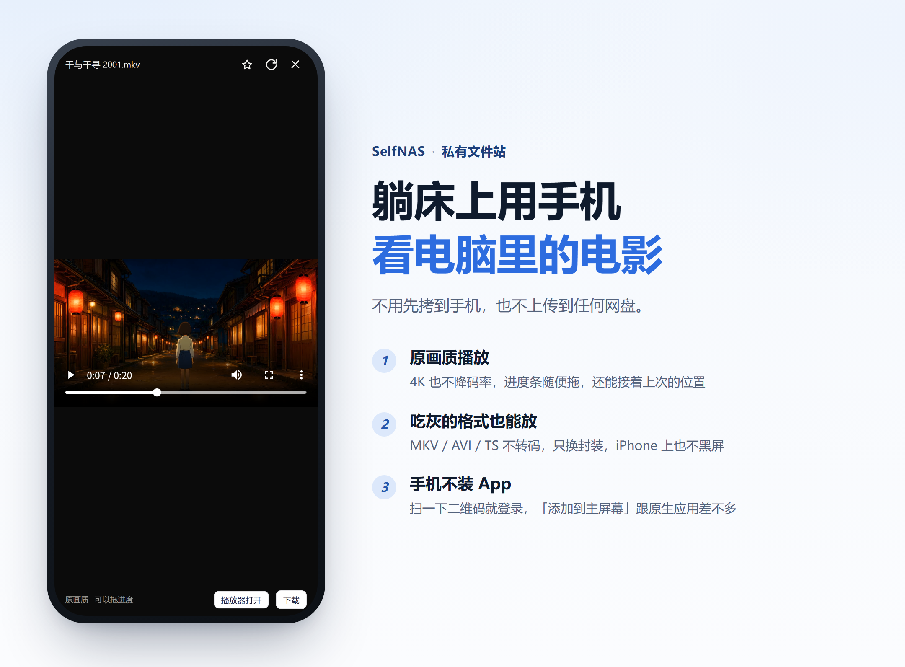

<table>
<tr>
<td width="20%" align="center"><b>手机看片</b><br><sub>4K MKV 不转码，点开秒播</sub></td>
<td width="20%" align="center"><b>照片回传</b><br><sub>断了接着传，只补缺口</sub></td>
<td width="20%" align="center"><b>随手翻盘</b><br><sub>几块硬盘，一个入口</sub></td>
<td width="20%" align="center"><b>听自己的歌</b><br><sub>无损就是无损，不上传</sub></td>
<td width="20%" align="center"><b>数据不出门</b><br><sub>没有云，没有账号体系</sub></td>
</tr>
</table>

## 它解决什么问题

家里那台常年开机的电脑，硬盘里存着几个 T 的电影、几万张照片、一堆资料。

- 想**躺床上用手机看**里面的电影 —— 拷到手机太麻烦，装一整套 Emby / Jellyfin 又太重，还常被 MKV 播不了卡住；
- **手机拍的照片和视频**想传回电脑，用大屏剪片、修图，比在手机上顺手得多；
- 有时候只是想在手机上**随手翻一下某个盘里的文件**，不想开远程桌面；
- 想听的歌**在自己硬盘里**（无损、整轨、Live 版），音乐 App 上没有，或者要会员 —— 又不想再装一套 Navidrome。

SelfNAS 就干这几件事：打开网页就能用，扫码就登录，手机上什么都不用装；听歌可以只用网页，也可以用任意 Subsonic App 连上来。

---

## 界面

### 手机上

同一个 WiFi 下扫管理台给的二维码，输一次密码，之后长期免登录。「添加到主屏幕」之后跟原生 App 差不多。

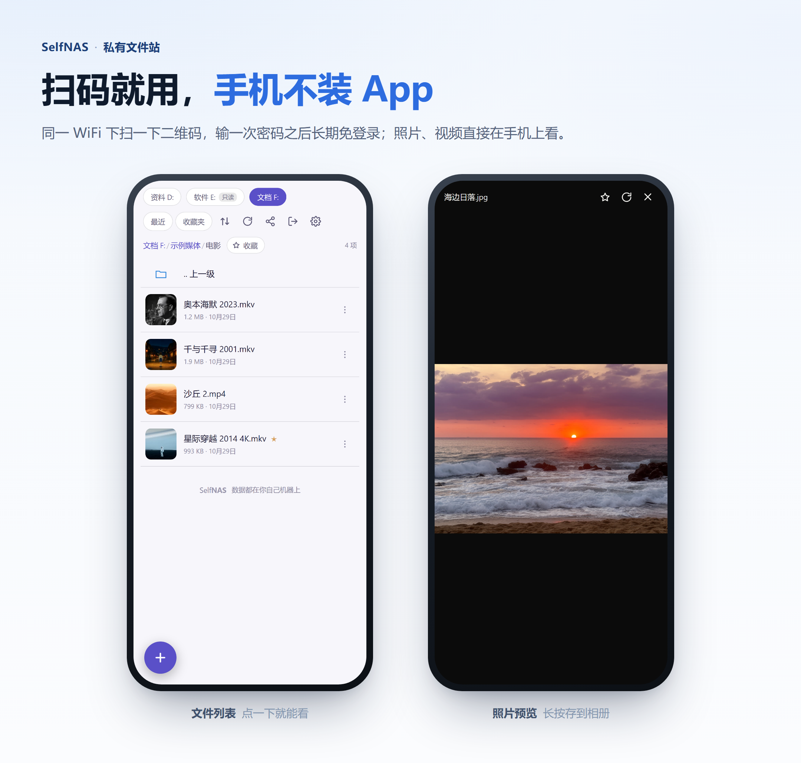

### 电脑上

浏览器打开 `http://<地址>/files`，跟手机上看到的是同一套界面，只是宽一点。

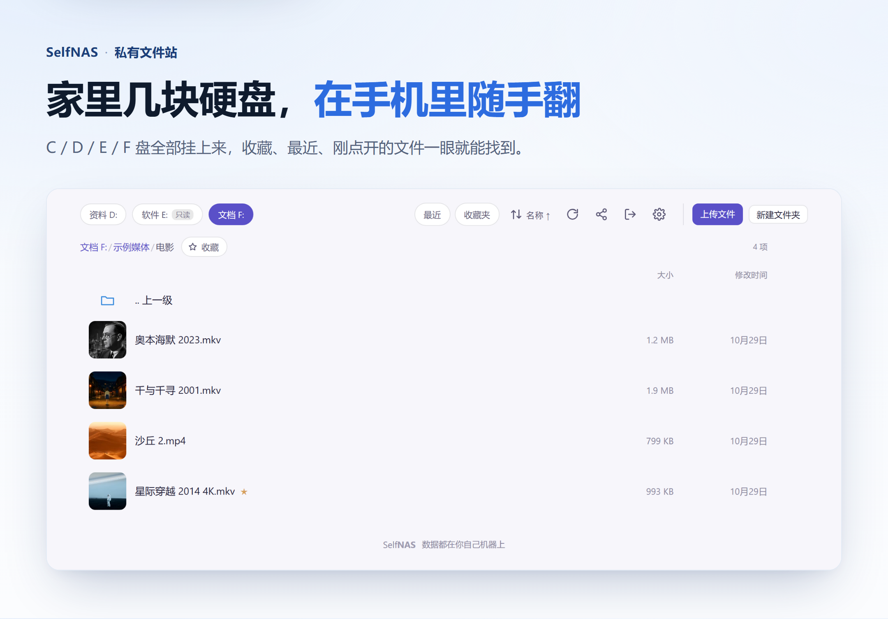


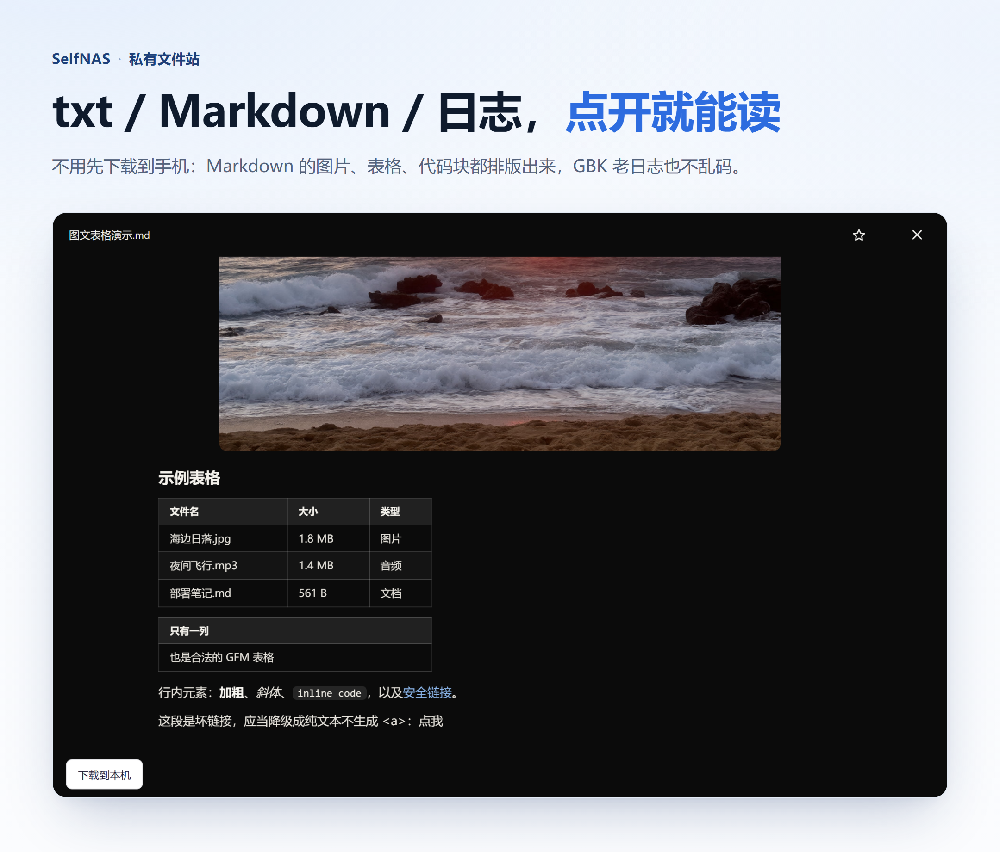

<sub>同一个查看器里：Markdown 的图片、表格、代码块、引用都按排版显示（GitHub 风格的 README 也能直接读）；txt / 日志 / 配置按纯文本显示，GBK 老日志不乱码。</sub>

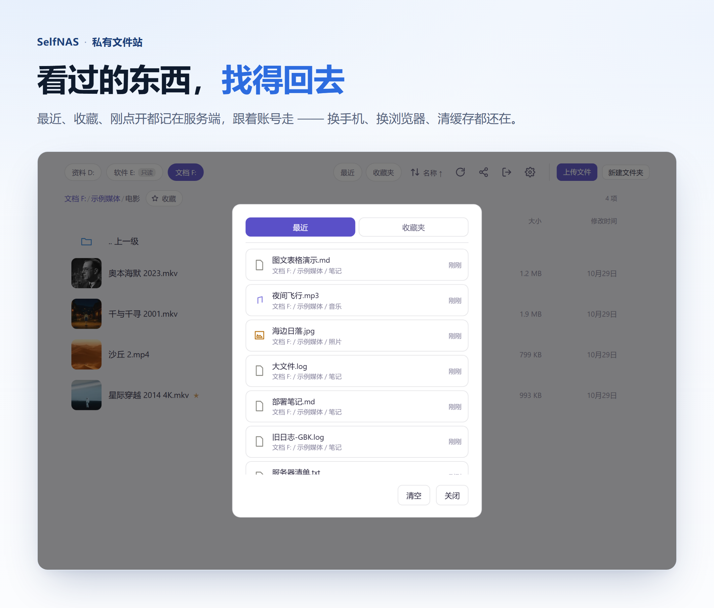

<sub>「最近」记的是文件，点一条就跳到它所在的目录、高亮那一行、然后打开它。「收藏」文件和文件夹都能收。两者都存在服务端，跟着账号走。</sub>

### 音乐

顶栏的「音乐」就是硬盘曲库本身 —— 点一首就播，黑胶转起来，歌词跟着走。

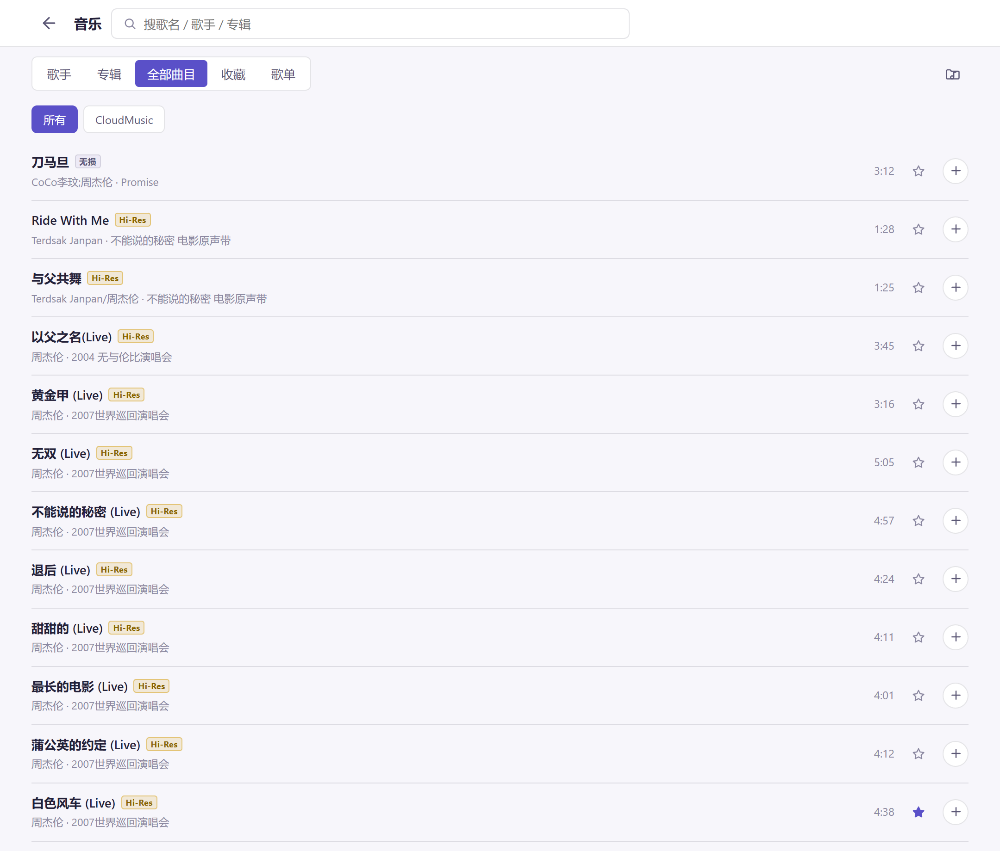

<sub>按歌手 / 专辑 / 全部曲目 / 收藏 / 歌单组织；全部曲目顶上还有一排曲库文件夹筛选条。歌名后面那枚小标是<b>读文件头</b>判出来的真规格：位深 ≥ 24 bit 或采样率 &gt; 48 kHz 标 Hi-Res，无损容器但只有 CD 规格标「无损」。<b>不看扩展名</b> —— 我库里三百多个 <code>.mp3</code> 其实是 FLAC，下载器给改的名。</sub>

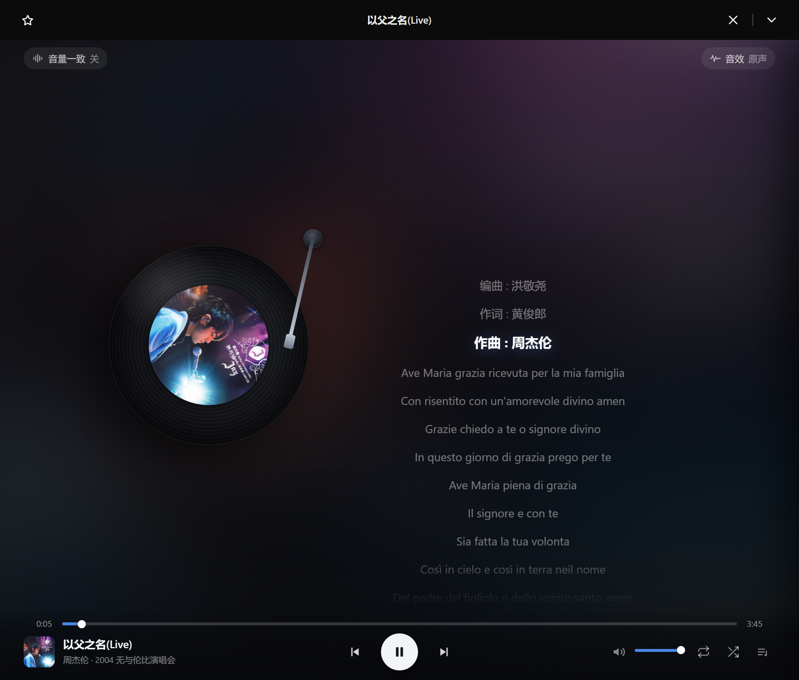

<sub>黑胶、歌词、底部控件都是自己画的：封面从标签里抠（没有就看同目录的 <code>cover.jpg</code>），歌词优先取同名 <code>.lrc</code>，没有再读标签里内嵌的。左上「音量一致」和右上「音效」是两个独立开关，切了会换一条流重新拉，进度接着走。</sub>

### 分享

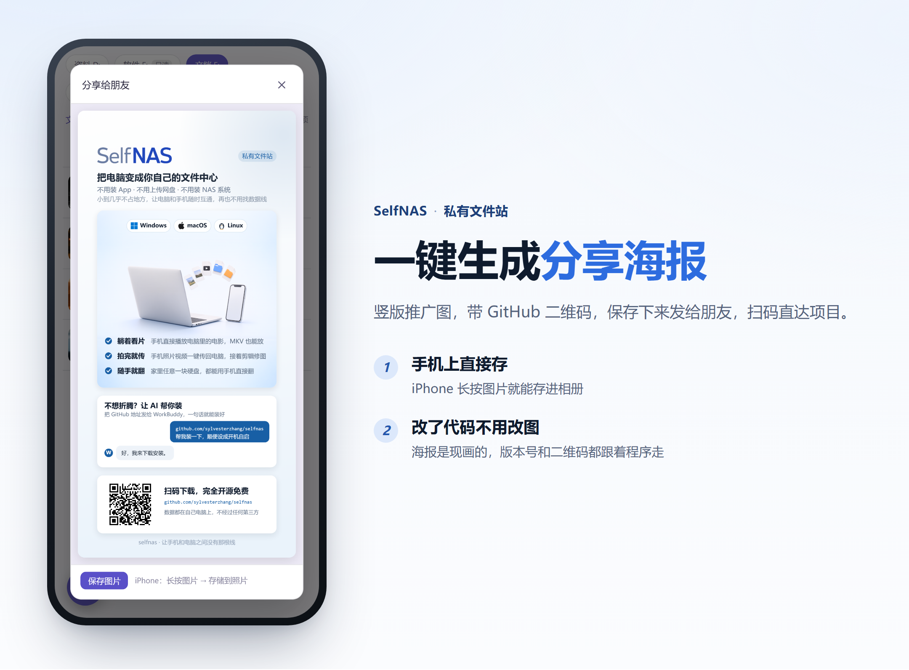

<sub>顺手生成一张竖版海报，带 GitHub 二维码，存下来发给朋友，扫码直达项目。海报是现画的 —— 改了代码，图上的版本号跟着变。</sub>

---

## 多账号

一台机器上存着几个 T 的东西，通常不止一个人想用 —— 但不想把管理员密码给出去，
更不想让人看见不该看的那几个盘。

给每个人单独开一个账号，勾上他该看的文件夹就行。没勾的，在他那边**根本不存在**：
不是点进去被拒绝，是列表里压根没这一项。同一个文件夹还能对不同人给不同权限 ——
妈妈对「家庭相册」能传能删，爸爸只能看。

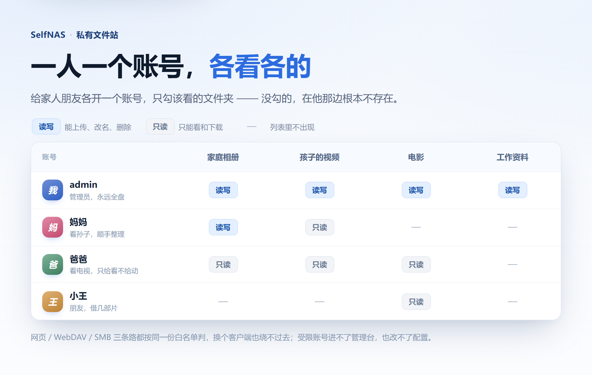

<sub>在管理台「账号与权限」里建：填用户名密码，勾文件夹，每条单独切「只读」。建完把地址和密码发给他就行。曲库同理：受限账号能看到的歌 = 他的白名单文件夹 ∩ 曲库。</sub>

---

## 七套皮肤

只换配色和字体，不动布局。默认是雾紫；电子书那套连正文都换成衬线字体，读长文不累；「经典」就是管理台自己那套设备蓝，选它文件站跟管理台同一个调子。

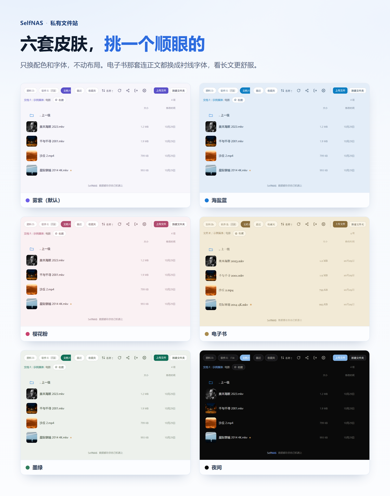

<sub>在管理台「系统设置 → 文件站外观」里选，保存后手机上刷新一下就是新配色。</sub>

---

## 管理台

一个网页管完所有设置：根目录、账号、端口、开机自启、访问日志、传输记录、缓存占用。改完立刻生效，不用重启。

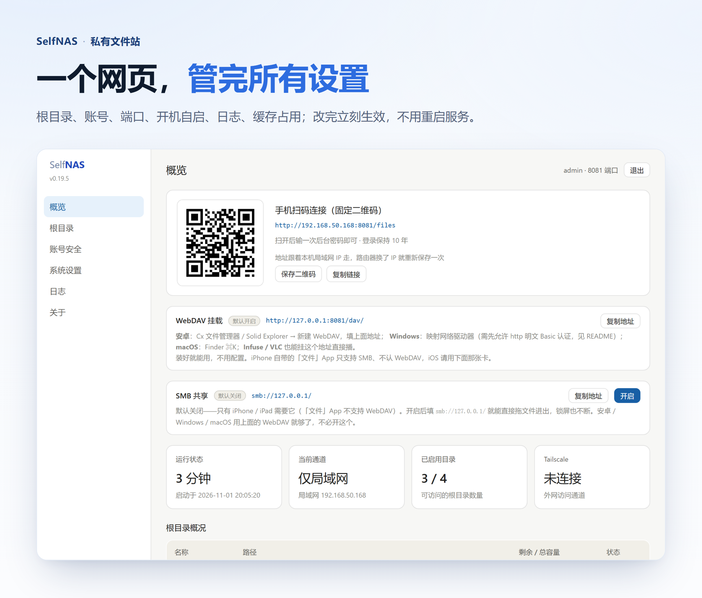

---

## 特性

**音乐**
- 曲库不是「全盘扫」：只在音乐页右上角（曲库管理）把放音乐的文件夹标进来，就扫这些目录 —— 下载目录里散落的三五个音频不会被凑成一张专辑
- 进音乐页先做一次轻量盘点（只比文件名 + 大小 + 修改时间，不读标签），跟库里有差异就在后台增量扫；不驻留文件监听，新加的歌过几秒自己出现
- 五个标签页：歌手 / 专辑 / 全部曲目 / 收藏 / 歌单；全部曲目顶上还有一排「曲库文件夹」筛选条
- **播放页**：黑胶 + 封面 + 歌词，底部是自绘控件 —— 进度可拖、音量、上一首 / 下一首、循环三态（列表 / 单曲 / 关）、随机、队列抽屉
- **点歌先不打断浏览**：点一行只是开始在底部迷你条里播，你可以接着翻列表、换标签页；点条子中间才展开全屏
- **锁屏 / 切后台不断**：前端就是一个普普通通的 `<audio>`，没有 Web Audio（原因见「踩过的坑」），Media Session 把歌名、封面、上一首 / 下一首交给系统锁屏界面
- **刷新或关掉页面再回来，队列和位置还在**（存本机 localStorage，不占服务端）
- **歌单**：建、改名、删；加歌在弹框里点一行勾一行，勾几首加几首（按钮上带数字），已在歌单里的标「已在」并灰掉；歌单详情里也能勾一批一起移除
- **Hi-Res / 无损标记**：读 FLAC / WAVE 文件头判位深与采样率，判不出来才按码率兜底
- 封面优先内嵌图，没有就用同目录 `cover.jpg` / `folder.jpg`；歌词优先同名 `.lrc`（大小写不敏感），没有才用内嵌标签；网易云那种 `[00:00.00]暂无歌词` 的占位文件会被认出来当没有

**音效（后端 EQ）**
- 五个预设：原声 / 温和低音 / 重低音 / 人声清晰 / 明亮细节；另有独立的「音量一致」开关，可叠加任意预设
- **滤波在服务端用 ffmpeg 算**，前端只播一条普通音频流 —— 所以 iOS 最小化、锁屏、切后台都不会停（前端 Web Audio 那条路走不通，见「踩过的坑」）
- **边转边发**：请求进来就开转，第一个字节就是处理后的声音；不做「先听原声、转好再换源」那种卡一下 + 音色突变的做法
- 顺着把整首落盘，下次同参数直接发文件：热首包 30~50 ms，冷首包 45 ms 上下
- **能拖进度**：输出固定 320k CBR（LAME 用填充帧把码率钉死在 40000 B/s），于是「字节区间」可以直接换算成「时间区间」，`Range` 请求按 `-ss / -t` 切，误差不超过一帧
- **音量一致只提不压**：目标 -10.5 LUFS，比它响的歌一个 dB 都不动，只把偏小的老录音往上提（最多 +12 dB，且受真峰值 -0.1 dBTP 约束）
- 开「音量一致」时第一首新歌要先量一遍响度（Hi-Res 大文件约 2 秒），量完记进库，之后 30 ms 级
- 缓存按「开关 + 预设」分目录，参数一改整目录作废重转（算法版本号进缓存 key）；总占用超过 8 GB 就按最旧的删。没装 ffmpeg 就自动退回原声，播放不中断

**手机听歌（Subsonic 兼容层）**
- 同一个端口的 `/rest/`，不另开端口：Substreamer / play:Sub / DSub 这类原生 App 直接连，锁屏、耳机线控、离线缓存全交给 App
- 歌单和网页**共用一张表**（按账号隔离）：App 里建的歌单，网页刷新就能看见，反过来也一样，不需要同步
- 曲目 id 是自描述的（`tr-` + base64url(root|path)），重启后同一个文件还是同一个 id，App 的缓存不会全部失效
- **报真实容器**：FLAC 装成 `.mp3` 也回 `audio/flac`，ExoPlayer 不会挑错解码器（这条踩过，见「坑」）
- 覆盖的端点：`ping` `getLicense` `getUser` `getMusicFolders` `getIndexes` `getArtists` `getArtist` `getAlbum` `getAlbumList(2)` `getSong` `getRandomSongs` `search(2,3)` `getGenres` `getMusicDirectory` `getPlaylists` `getPlaylist` `createPlaylist` `updatePlaylist` `deletePlaylist` `getLyrics` `getCoverArt` `stream` `download` `getScanStatus` `startScan`
- 没实现的（`star` / `unstar` / `scrobble` / `setRating` / `getStarred2` / `savePlayQueue` …）一律回 `status=ok` 空结果 —— App 对空列表很宽容，对 500 很敏感
- 鉴权同时支持标准 token（`u` + `t` + `s`）和明文 / `enc:` 密码。token 是 `md5(密码 + salt)`，而我们只存了不可逆的哈希，所以另外存一份 AES-GCM 密封的明文副本（key 由 `secret` 派生）—— **从没用网页登录过的账号要先登录一次**，否则会回一条带指引的 40 错误

**视频播放**
- MKV / AVI / TS 这类 iOS Safari 播不了的容器，**不做转码，只换封装**：`-c:v copy` 把码流原样搬进 fragmented MP4，4K 也是几毫秒起播
- 播不了才降级转码（可选，需要 ffmpeg）
- 前台先问「能不能播 / 要不要换封装 / 只给下载」，不让人对着黑屏等
- **缺 ffmpeg 的时候在疼的地方给药**：碰上要转码的格式，播放器里直接给一个「立即安装并播放」—— 下载、解压、校验、热生效，装完接着播，全程不用知道 ffmpeg 是什么
  - 默认拉的是 Windows 的 essentials 构建（约 90 MB 的包，只用里面的 ffmpeg / ffprobe）；国内直连慢就在配置里把 `ffmpegUrl` 换成镜像
  - Linux / macOS 用自己的包管理器装更省事，装完在管理台刷新一下就认到了
- **接着上次看**：播放进度按账号记在服务端，重开视频自动跳到上次位置（看完或拖回开头则清除）
- **投屏到电视（DLNA）**：播放页里点「投屏」，局域网里的电视 / 盒子（SSDP 发现）列出来，选一台就推过去。视频本体是电视自己从这台机器拉的签名直链，不经过服务端中转，也不占手机电量
- **外部播放器**：视频 / 音频预览底部点「播放器打开」，生成一条**短期签名直链**（6 小时有效，签名绑定路径 + 大小 + 过期时间，密钥是配置里的 `secret`）—— iPhone 上自动唤起 VLC，没装就复制链接，粘到 Infuse / VLC / nPlayer 的「打开 URL / 网络串流」即可

**文件**
- 浏览、上传、下载、删除、重命名、移动、新建文件夹
- 上传走并行分片 + **按区间记录的断点续传** —— 写入是乱序的，靠一张已完成区间表判断「收齐了没有」，中断重传只补缺口
- 路径解析强制限定在配置的根目录内，越界直接 403
- 视频 / 图片缩略图懒加载，几百张图的目录也不会把接口拖死；缩略图跟着文件内容走，同名文件被替换会自动刷新
- **文本文件在线预览**：txt / Markdown / 代码 / 日志 / 配置点开直接看，手机上查笔记、翻日志不用先下载；GBK 编码的老日志也不会乱码
  - **Markdown 是完整排版**：图片（相对路径、`F:\…` 绝对路径、外链都行）、表格、代码块、引用块都渲染出来，阅读宽度收在 880px，长文不糊脸
  - 只读不改 —— 改文件还是回电脑上改更稳妥

**手机接入**
- **固定二维码**，不是一次性的：管理台里那张码就是个永久地址，贴在冰箱上、打印出来夹在本子里都行，扫码进来输一次后台密码就登录（登录态保持 10 年，除非你清缓存）。早先做过「一次性 + 120 秒过期」，实践下来是过度设计 —— 每次都要跑回电脑点刷新，比直接输个密码还麻烦
- 自带 PWA manifest，可以「添加到主屏幕」，用起来跟 App 差不多
- **WebDAV 挂载（默认开启，装好就能用）**：管理台给出 `http://<地址>/dav/`，安卓文件管理器（Cx / Solid Explorer）、Windows「映射网络驱动器」、macOS Finder ⌘K 都能直接连上，把照片视频拖进去就行
  - 传输交给**操作系统**，锁屏、切 App 都不会断 —— 浏览器传大文件最怕的就是熄屏后页面被系统挂起
  - Infuse / VLC 挂这个地址也能直接播，比逐条开预览顺手
  - 路径按根目录名分：`/dav/资料/…`、`/dav/软件/…`，只读根目录会拒绝写入
- **SMB 共享（默认关闭，只给 iPhone / iPad 用）**：苹果自带「文件」App **从来就没做过 WebDAV 客户端**，只认 SMB。所以自带了一个 SMB 服务（SMB 2.1 – 3.1.1，纯 Go），开起来之后「文件」App 里「连接服务器」填 `smb://<地址>`，账号就是登录 SelfNAS 的账号，每个根目录自动变成一个共享
  - 为什么默认关闭：安卓 / Windows / macOS 用 WebDAV 就够，而开 SMB 要**抢 Windows 自带的 445** —— 两害相权，让需要的人自己点
  - **开启时会明确告诉你代价**：Windows 自带的「文件共享 / 网络邻居」会被停掉并设为开机不启动（点确认、弹一次管理员授权之后才动手）
  - **关闭时会自动还回去**：445 交回系统，`LanmanServer` 改回「自动」并拉起。万一授权被取消、没还成，卡片上会挂着「恢复 Windows 自带共享」按钮，点一下重试
  - iOS 的 SMB 客户端**写死 445 端口**，填 `smb://ip:4450` 它照样去连 445。所以「接管」不是可选项，是这条路的前提
  - 共享名就是根目录名（`资料` `软件` `文档`），只读根目录在 SMB 里也是只读
  - **签名是关的**：iOS 复合请求只对整包签名，逐段校验会全判失败。代价是这条链路在局域网里是明文 —— **只在内网用，要出外网就得上 HTTPS/WSS 隧道**（Tailscale、frp + TLS 之类），别把 445 往公网映射

**找得回去**
- 「最近」记录**文件级**浏览历史，点一下跳到所在目录、高亮那一行、然后打开它
- **刚点开的文件会一直标出来**：文件名换主题色 + 左侧色条，关掉播放器、刷新页面都还认得出刚才开的是哪个（按账号存服务端）
- 「收藏」支持文件和文件夹
- 两者都存服务端 SQLite，跟账号绑定 —— 换手机、换浏览器、清缓存都还在（早期版本存在 localStorage，本质只属于那台设备，已废弃）
- 表里**只存路径不存元信息**，读的时候现 `stat`：文件被删 / 改名，列表里直接标「已不在」，不留骗人的旧记录

**账号与权限**
- 管理员 `admin` 永远是全盘
- 可以再建**受限账号**：每个账号单独配一份「允许访问的文件夹」白名单，每条还能单独标只读
  - 网页 / WebDAV / SMB 三条链路都按同一份白名单判，只读目录上传、改名、删除、移动一律拒绝
  - 受限账号连 SMB 只看到一个共享入口，点进去是白名单文件夹的合并视图；连 WebDAV 也一样
  - 受限账号能登文件站网页、能连 WebDAV 和 SMB、能用 Subsonic App，但进不了管理台 —— 管理台只认 `admin`
  - 密码只存 NT hash（SMB 认证要的那一份）。网页登录和 WebDAV 的 Basic 认证拿到的是明文，现算一次 NT hash 比对即可，不用再存一套 PBKDF2

**外观**
- 七套皮肤（雾紫 / 海盐蓝 / 樱花粉 / 电子书 / 经典 / 墨绿 / 夜间），选一套全局生效 —— 所有账号、所有设备看到的是同一个配色
- 只管文件站，管理台**永远是「经典」那套**、不跟着换：工具就该有个工具的样子
- 皮肤只动色调和字体，不动布局。电子书那套把正文换成衬线字体，看长文更舒服

**管理**
- 网页管理台：端口、根目录（增删改、可标只读）、改密码、看日志、看传输记录、看缓存占用
- **开机自启**：管理台里一个开关。Windows 直接写计划任务（开机后在后台把服务拉起来，不弹黑窗口、不用先登录桌面）；Linux / macOS 生成 systemd unit / LaunchDaemon plist 并给出一条复制就能跑的命令，装不装由你决定
- **检查更新**：点一下才去查 GitHub Releases（不偷偷联网），结果存下来，有新版本时「关于」按钮旁挂个红点
- **一键重新扫描磁盘**：新硬盘、新分区、双系统里另一个系统多出来的盘，点一下自动加进根目录；已有的条目（改名 / 只读 / 禁用）不会被覆盖
- 配置改动热生效，不用重启 —— 包括根目录的增删改：WebDAV 每次请求都现读配置；SMB 是**就地改共享表 + 切换共享背后的 VFS**（不重启监听、不断连接）：关掉的盘会立刻从共享列表里消失，已经打开它的客户端当场变成 `Access denied`，**把盘再打开之后原来那个位置直接就能用**，不需要在手机上删连接重加

---

## 快速开始

### 直接下载

到 [**Releases**](https://github.com/sylvesterzhang/selfnas/releases) 拿对应平台的压缩包，解压就能跑，不用装 Go：

| 平台 | 文件后缀 |
|---|---|
| Windows（64 位） | `windows-amd64.zip` → 双击 `selfnas.exe` |
| Linux x86_64 | `linux-amd64.tar.gz` |
| Linux ARM64（树莓派等） | `linux-arm64.tar.gz` |
| macOS Intel | `darwin-amd64.tar.gz` |
| macOS Apple Silicon | `darwin-arm64.tar.gz` |

Linux / macOS 解压后先加执行权限：

```bash
chmod +x selfnas && ./selfnas
```

> macOS 首次运行可能提示「无法验证开发者」（二进制没做代码签名，个人项目签不起 99 美元的年费）：
> ```bash
> xattr -d com.apple.quarantine ./selfnas
> ```

每个包都带 `SHA256SUMS`，介意的话可以核对一下。

> **测试范围**：Windows 是主力环境，功能都在上面跑过。Linux 的 amd64 / arm64 包已经在真机上部署验证过（x86 小主机和 ARM 盒子各一台）。macOS 只是交叉编译产物，手上没有机器，没有实际跑过 —— 遇到问题请直接到 [Issues](https://github.com/sylvesterzhang/selfnas/issues) 提，看到就会跟进。

### 自己编译

需要 Go 1.24+。**不需要 cgo、不需要 GCC**，`CGO_ENABLED=0` 直接交叉编译。

```bash
git clone https://github.com/sylvesterzhang/selfnas.git
cd selfnas
go build -o selfnas.exe .
```

Linux / macOS：

```bash
CGO_ENABLED=0 GOOS=linux GOARCH=amd64 go build -o selfnas .
```

要一次编出全部五个平台（Windows / Linux / macOS × amd64、arm64）并打包：

```bash
python scripts/build.py      # 只编 Windows 就 python scripts/build.py windows
python scripts/release.py    # 打成 zip / tar.gz + SHA256SUMS，产物在 dist/
```

发布用的二进制走 `-trimpath -ldflags "-s -w"`，20 MB 压到 15 MB 左右。版本号只写在 `main.go` 的 `const version` 一处，两个脚本都会去读它。

> 前端是 `//go:embed` 打进二进制的：**改完 `web/` 里的 CSS / JS 必须重新 `go build`**，只刷新页面看到的永远是旧样式。

### 运行

```bash
./selfnas.exe
```

首次启动会**自动生成 `config.json`**，并把本机磁盘枚举成根目录。账号密码是固定的：

```
账号 admin    密码 123456
```

登录管理台后第一件事就是改掉它 —— 管理台里有「修改密码」区块，填原密码和新密码就行。

> 早先版本是随机生成密码打印在控制台，实践下来不好用：双击 exe 启动时控制台一闪就没了，密码等于没给，还得去翻日志。固定默认密码至少能让人进去。

启动横幅：

```
================================================
  selfnas 0.20.0
  管理台:  http://127.0.0.1:8080/admin
  局域网:  http://192.168.1.100/admin
  配置:    ./config.json
  数据:    ./selfnas.db
  账号:    admin
  密码:    123456（默认密码，请登录后到管理台修改）
================================================
```

### 手机接入

1. 电脑上打开管理台 → 概览页那张二维码（可以「保存二维码」或「复制链接」）
2. 手机（同一 WiFi）扫码 → 输一次密码 → 之后长期免登录；二维码本身是固定的，不用每次重新生成
3. 想更顺手就在 Safari / Chrome 里「添加到主屏幕」
4. **传大文件走 WebDAV（默认开启，不用配置）**：管理台概览页有 `http://<地址>/dav/`，安卓用 Cx 文件管理器 / Solid Explorer，Windows 用「映射网络驱动器」，macOS 用 Finder ⌘K，填地址和账号密码即可；拖文件进去就走系统后台传输，锁屏不断
   - 📱 **iPhone / iPad 例外**：苹果自带的「文件」App **只支持 SMB，不支持 WebDAV**（填 `/dav/` 地址会报「此 URL 不受支持」）。所以 iOS 用管理台里的「SMB 共享」卡（**默认关闭**）：点「开启」→ 确认框会讲明「会停掉 Windows 自带的文件共享 / 网络邻居，并设为开机不启动」→ 输一次后台密码 → 弹管理员授权 → 然后「文件」App → 连接服务器 → `smb://<地址>` → 注册用户，账号密码就是 SelfNAS 的登录账号密码
     - 不用了就点「关闭」：445 会还给 Windows，自带共享自动恢复。中途取消授权导致没还成的话，卡片上会有「恢复 Windows 自带共享」按钮
   - 🪟 Windows 资源管理器：默认禁止 http 明文 Basic 认证，得先把 `HKLM\SYSTEM\CurrentControlSet\Services\WebClient\Parameters` 下的 `BasicAuthLevel` 改成 `2`、重启 `WebClient` 服务，之后「映射网络驱动器」填 `http://<地址>/dav/`
   - ⚠️ 局域网是 http，Basic 认证的密码是明文传输的，**别把这个端口直接暴露到公网**；要在外网用，前面套一层 HTTPS 反代

### 把歌加进曲库

1. 电脑上打开文件站 → 顶栏「音乐」→ 右上角那个**带音符的文件夹**（曲库管理，只有管理员看得见）
2. 选中放音乐的目录 → 保存，它就开始扫（只读文件名 / 大小 / 时间，快的目录几秒）
3. 手机刷新「音乐」页就能看到歌手 / 专辑 / 全部曲目

曲目不动文件本身，只是建索引；把某个目录移出曲库也只是清记录，硬盘上的歌一首不少。想重新扫一遍就在曲库管理里点「重新扫描」。

### 用手机 App 听歌（Subsonic）

网页能听，但 iOS 的后台播放终究不如原生 App 稳（锁屏、耳机线控、离线缓存这些）。所以内置了一套 Subsonic 兼容层：

1. 确认曲库已经有歌（上一步）
2. App 里添加服务器，填 `http://<地址>:<端口>`（就是文件站那个地址，不另开端口）
3. 账号密码 = SelfNAS 的登录账号密码。**如果这个账号从没用网页登录过，先去网页登一次** —— token 鉴权需要一份可逆的密码副本，它是在登录成功那一刻写下的
4. 标准 Subsonic 客户端都能连。我这边长期在用的是 Substreamer（iOS / Android），play:Sub、DSub 走的是同一套接口

歌单跟网页共用一张表：App 里建一个「开车听的」，回到电脑上刷新网页就能看见。反过来也成立。

> 换设备 / 换服务器地址之后，有些 App 会拿着**旧服务器签发的 id** 来要歌（Substreamer 会把曲库缓存在本地）。服务端对这种情况有文件名兜底：旧 id 里解出来的路径找不到时，按文件名在可播范围里唯一匹配一次；同名有多个就不猜，直接报错。

### 平台差异

这个项目是在 Windows 上长出来的，三个平台的行为大部分一致，差别集中在「第一次启动怎么找到磁盘」和「开机自启怎么装」：

| | Windows | Linux | macOS |
|---|---|---|---|
| 首次启动枚举磁盘 | ✅ 自动把 C/D/E/F 列成根目录（C 盘默认关闭） | ✅ 家目录 + `/media`、`/mnt` 下已挂载的外部存储（跳过系统挂载点和虚拟文件系统） | ✅ 家目录 + `/Volumes` 下的真实卷 |
| 盘符显示 | 显示 `D:` `E:` 帮助认盘 | 无盘符，显示目录名 | 无盘符，显示卷名 |
| 路径长这样 | `D:\视频` | `/mnt/media` | `/Volumes/移动硬盘` |
| 开机自启 | 直接写计划任务，一个开关搞定 | 生成 systemd unit +「复制就能跑」的安装命令，自己敲 | 生成 LaunchDaemon plist + 安装命令，自己敲 |
| SMB 占 445 | 要先停掉系统自带的 `LanmanServer` / `srv2` / `srvnet` | 445 本来就空着，直接绑 | 同上 |
| 其余功能（含音乐 / 音效 / 投屏） | 一致 | 一致 | 一致 |

> Linux / macOS 的自启之所以不自动装：那一步要往 `/etc/systemd/system` 或 `/Library/LaunchDaemons` 写文件、要 root，而且动的是系统目录 —— 给一条能看清内容的命令，比自己偷偷往里写更合适。另外 80 和 445 都是特权端口，unit 里用 `CAP_NET_BIND_SERVICE` 单独授权，而不是把服务整个跑成 root。

---

## 配置

`config.json`（首次启动自动生成，也可以在管理台改）：

```jsonc
{
  "port": 8080,              // 监听端口
  "bind": "0.0.0.0",         // 0.0.0.0 = 局域网可访问
  "user": "admin",
  "passHash": "...",         // 自动生成，别手改
  "secret": "...",           // 会话签名 + 直链签名 + Subsonic 密码副本的密钥，泄露即可伪造登录态
  "roots": [                 // 能访问哪些目录，就这么白名单
    { "name": "资料", "path": "D:\\", "readonly": false, "enabled": true },
    { "name": "电影", "path": "E:\\Movies", "readonly": true,  "enabled": true }
  ],
  "scopedAccounts": [        // 受限账号：只能看白名单里的文件夹
    {
      "user": "zh",
      "ntHash": "...",       // 只存 NT hash，用于 SMB / WebDAV 认证
      "folders": [
        { "path": "D:\\视频", "readonly": false },
        { "path": "E:\\音乐", "readonly": true  }
      ]
    }
  ],
  "musicLibrary": [          // 曲库：只扫这些目录（音乐页右上角也能改）
    "D:\\CloudMusic"
  ],
  "adminOnlyLocal": false,   // 管理台默认不限本机（无头 Linux/NAS 要从别的电脑访问）；要收紧改 true
  "theme": "light",          // 文件站皮肤：light / blue / pink / ebook / green / dark / nas
  "uploadConcurrency": 2,    // 并行上传的分片数，千兆有线可以开到 4
  "sessionDays": 3650,
  "ffmpeg": "",              // 留空则自动查找（转码和音效都靠它）
  "ffmpegUrl": "",           // 一键安装 ffmpeg 时用的下载地址，留空走默认
  "smb": {                   // iPhone / iPad 用，默认关；建议在管理台里开关
    "enabled": false,
    "port": 445,             // iOS 只认 445，改了就连不上
    "ntHash": "...",         // 后台密码的 NT hash，改密码时自动同步
    "tookOver": false        // 系统自带的 SMB 是不是被我们关掉了（关 SMB 时据此还回去）
  }
}
```

> `adminOnlyLocal` 默认是 `false`。理由是 NAS 场景基本都是无头机，管理台要从另一台电脑打开；真机上换了 IP 还得远程改配置，很难受。要收紧就在管理台「访问与安全」里打开 —— 那种模式下只放行本机和 Tailscale 网段。

> ⚠️ **不要手写 `config.json` 再启动。** 一份只写了 `port` 的极简配置会让「首次启动 → 建管理员账号」那条路被跳过，之后所有登录都 401，看起来像密码错。要改就让它自己生成，再在管理台里改。

### 关于 ffmpeg

**不装也能用。** 只是 MKV / AVI / TS 之外的格式能直连播的会直连播，需要转码的会降级成下载；**音效和「音量一致」也会自动关掉**（回原声），不会因为缺这个依赖把播放搞坏。

装了 ffmpeg 才有「换封装」「转码」「EQ」「响度均衡」这几条路。`ffmpeg` 字段可以写绝对路径，也可以留空让它自己找（会优先找能跑 NVENC 硬编的那份）。

懒得自己装的话，碰上要转码的视频时播放器里会问一句「立即安装并播放」，点一下它自己下载解压、装好接着播。默认地址是 Windows 的 essentials 构建，国内慢就改 `ffmpegUrl`。

> 音效是**每一首现转**的：320k MP3 的转码成本很低（一首 4 分钟的歌在桌面上也就几秒跑完，边播边转只占其中一小截），换来的是「不换元素、不改 Web Audio」——iOS 后台播放才稳。这也是为什么宁可服务端多算一遍，也不在前端接 `createMediaElementSource`。

### 关于 SMB（给 iPhone / iPad 用）

iOS 的「文件」App 只认 SMB，所以这部分不是可选锦上添花，是苹果用户的唯一通路。**默认是关的** —— 安卓和电脑用 WebDAV 就够了，只有 iOS 需要它，而它的代价不小：

- **端口只能是 445**：iOS 客户端不认 `smb://ip:端口` 这种写法，填了也按 445 连。而 Windows 的 445 默认被系统文件共享占着，所以开启时会接管它：停掉 `LanmanServer` / `srv2` / `srvnet` 并设为开机不启动（一次管理员授权）。**开启前会弹确认，把这件事说清楚** —— 接管之后本机的「文件共享 / 网络邻居」就用不了了。
- **关闭时会自动还回去**：`LanmanServer` 改回「自动」并启动，445 交回系统。授权被取消导致没还成的话，卡片上会出现「恢复 Windows 自带共享」按钮，点一下重试（`config.json` 的 `smb.tookOver` 记的就是这个状态）。
- **NTLM 需要 NT hash**，而网页登录只存 PBKDF2（算不出 MD4）。所以第一次开启 SMB 时会让你重输一次登录密码，校验通过后把 `hex(MD4(UTF-16LE(密码)))` 存进 `config.json` 的 `smb.ntHash`；改密码时自动跟着更新。

只在内网用。签名强制是关的（原因见下面「踩过的坑」），要在公网用请套 HTTPS 隧道，别直接把 445 映射出去。

### 关于端口

默认 `8080`。挑端口时注意一个坑：**Chromium 系浏览器有一张禁用端口表**，撞上就是 `net::ERR_UNSAFE_PORT`，服务端 `curl` 返回 200 一切正常，只有浏览器打不开。典型的是：

- `6000`（X11）
- `6665–6669`（IRC）
- `1` `7` `9` `11` `13` `15` `17` `19` `20` `21` `22` `23` `25` `37` `42` `43` `53` `69` ...

程序启动时会检测并在横幅里警告。

---

## 目录结构

```
selfnas/
├── main.go           入口：flag、配置加载、路由表、启动横幅
├── fsops.go          文件操作：路径解析 / 列目录 / 上传分片 / 移动 / 删除
├── play.go           播放：探测编码、判断能否 copy、实时换封装出流
├── thumb.go          缩略图：视频抽帧 / 图片缩放，落盘缓存
├── prep.go           预转码：提前把要转的落盘，播放时不用等
├── share.go          播放器直链：/api/fs/link 签发短期签名 /f 直链（给 Infuse/VLC 用）
├── webdav.go         WebDAV：/dav/ 挂载（安卓 / Windows / macOS 直接读写，后台传输）
├── scoped.go         受限账号：白名单文件夹 + 各自读写权限，网页 / WebDAV / SMB 共用
├── smb.go            SMB 服务：共享枚举 + 真实目录 VFS（iPhone / iPad 走这条）
├── smb_gate.go       可开关的 VFS 外壳：关掉一个盘而不断客户端连接，开回来原地恢复
├── smb_scoped.go     受限账号在 SMB 里的合并视图
├── smb_wire.go       SMB 协议线格式（NT hash、签名、消息头）
├── smbpipe.go        SMB 命名管道适配：iOS 用 WRITE + READ，不认 FSCTL_PIPE_TRANSCEIVE
├── smb_windows.go    接管 445：提权停掉系统自带的 LanmanServer / srv2 / srvnet
├── smb_other.go      非 Windows 平台的空实现（别的系统 445 本来就空着）
├── music.go          曲库：标记目录 → 扫描入库 → 歌手/专辑聚合、歌单、收藏
├── musicfmt.go       规格判定：读 FLAC / WAVE 文件头出位深与采样率（Hi-Res / 无损）
├── tags.go           标签与时长：标题 / 歌手 / 专辑 / 内嵌封面，ffprobe 补时长
├── art.go            封面与歌词：抠内嵌图、找同目录 cover.jpg / 同名 .lrc
├── eq.go             后端 EQ：滤波链、边转边发、响度均衡、按字节换算 seek
├── subsonic.go       Subsonic 兼容层 /rest/*（App 直连，含真实容器嗅探）
├── dlna.go           视频投屏：SSDP 发现 + SOAP 控制（AVTransport）
├── store_api.go      「最近 / 收藏 / 播放进度 / 刚点开」接口
├── theme.go          文件站皮肤（七套 CSS 变量预设）
├── api.go            鉴权、管理台接口、/api/state
├── autostart.go      开机自启（分平台：计划任务 / systemd / launchd）
├── autostart_unit.go systemd unit 与 launchd plist 的文本模板
├── disk_windows.go   枚举盘符
├── disk_linux.go     枚举家目录 + /media、/mnt 下的已挂载存储
├── disk_darwin.go    枚举家目录 + /Volumes 下的真实卷
├── disk_mountinfo.go 解析 /proc/self/mountinfo
├── ffmpeg_dl.go      ffmpeg 一键下载安装
├── update.go         版本检查（手动触发，结果落缓存）
├── db.go             SQLite（modernc.org/sqlite，纯 Go 无 cgo）
├── qr.go             二维码 token 与地址拼装
├── log.go            访问日志与传输记录
├── scripts/
│   ├── build.py      交叉编译五个平台
│   ├── release.py    打 zip / tar.gz + SHA256SUMS
│   └── make_icons.py 画图标（黑底白 S，含 favicon.ico 与 PWA 各尺寸）
├── third_party/go-smb/   SMB 库的本地副本（MIT），只改了几处越界与会话处理
├── docs/screenshots/  README 里用的截图与宣传图
└── web/              前端，原生 JS 无框架无构建
    ├── admin.html / admin.js    管理台
    ├── files.html / files.js    文件站（文件 + 音乐播放器）
    ├── style.css                共用样式（含七套皮肤）
    └── manifest.json + icon-*   PWA（图标由 scripts/make_icons.py 生成）
```

前端刻意不引入构建工具：两个 HTML、几个 JS、一个 CSS，改完重新编译就是。好处是没有 `node_modules`、没有打包步骤，一个二进制里 `go:embed` 全带走。

---

## API

全部返回 `{ code, msg, data }`，鉴权靠 cookie `sn_token`（Subsonic 那套例外，走它自己的 `u` / `t` / `s`）。

| 方法 | 路径 | 说明 |
|---|---|---|
| POST | `/api/login` / `/api/logout` | 登录 / 退出 |
| GET | `/api/state` | 全量状态：版本、根目录、主题、SMB、Tailscale、缓存占用 |
| POST | `/api/settings` | 保存设置（字段都是指针，只改传了的那些） |
| GET | `/api/qr/token` | 管理台的固定二维码（内容就是永远不变的访问地址） |
| GET | `/api/fs/roots` | 根目录列表（含盘符） |
| GET | `/api/fs/list` | 列目录 `?root=&path=` |
| POST | `/api/fs/upload` | 分片上传（带区间记录，可续传） |
| GET | `/api/fs/playinfo` | 这个文件能不能播、要不要换封装 |
| GET | `/api/fs/play` | 换封装后的 MP4 流 |
| POST | `/api/fs/link` | 生成签名直链（给外部播放器 / 投屏 / 锁屏封面） |
| GET | `/api/fs/recent` | 最近浏览 |
| POST | `/api/fs/fav` | 收藏 / 取消收藏（同一接口 toggle） |
| GET/POST | `/api/fs/progress` | 播放进度：取 / 存（`pos<=0` 即删除记录） |
| GET/POST | `/api/fs/lastopen` | 「刚点开」标记：取 / 存 |
| GET/POST | `/api/fs/lastdir` | 每个盘上次待的目录（刷新后回到原处） |
| GET | `/api/fs/cover` | 封面（`?w=` 出多尺寸，白名单 96~640） |
| GET | `/api/fs/lyrics` | 歌词（同名 .lrc → 内嵌标签） |
| GET/POST | `/api/fs/prep` | 预转码 / 音效成品落盘 |
| GET | `/api/fs/cache/` | 取缓存产物（EQ 成品按区间取） |
| GET/POST | `/api/music/lib` | 曲库目录：列 / 增删 |
| POST | `/api/music/scan` | 触发一次扫描 |
| GET | `/api/music/status` | 扫描进度（done / total） |
| GET | `/api/music/artists` `/albums` `/tracks` | 歌手 / 专辑 / 曲目（带 `q` 规格字段） |
| GET/POST/PATCH/DELETE | `/api/music/playlist` | 歌单：列 / 建 / 改名 / 删 |
| GET/POST/DELETE | `/api/music/playlist/items` | 歌单条目：列 / 加（可批量）/ 移除 |
| POST | `/api/music/fav` | 收藏单曲（toggle） |
| GET | `/api/music/appinfo` | 给 App 看的连接信息（Subsonic 地址） |
| POST | `/api/dlna/devices` `/play` `/stop` | 投屏：发现 / 推 / 停 |
| * | `/rest/<endpoint>` | Subsonic 兼容层（App 直连，独立鉴权） |
| GET | `/api/fs/stats` | 条数与数据库占用 |
| GET/POST | `/api/scoped` | 受限账号：列 / 增删改 |
| POST | `/api/scoped/perm` | 改某个白名单文件夹的读写权限 |
| POST | `/api/smb/takeover` / `/api/smb/restore` | 接管 445 / 还回去 |
| POST | `/api/roots/rescan` | 重新扫描磁盘 |
| POST | `/api/autostart` | 开机自启开关 |
| POST | `/api/update/check` | 手动检查 GitHub 新版本（不自动轮询） |
| GET | `/api/logs/tail` | 日志尾部 |
| GET | `/api/logs/transfers` | 传输记录 |

---

## 数据文件

| 文件 | 内容 |
|---|---|
| `config.json` | 配置，**含密码哈希、会话密钥与 Subsonic 用的密码副本，不要外发** |
| `selfnas.db` | 「最近 / 收藏 / 播放进度 / 刚点开 / 曲库 / 歌单」，SQLite（WAL 模式） |
| `selfnas.db-wal` `selfnas.db-shm` | WAL 附属文件，**备份必须一起拷** |
| `cache/` | 转码产物 + 缩略图 + 封面 + EQ 成品（`cache/eq/<预设>/`），可随时删（管理台有占用统计） |

数据库路径可以用 `-db` 指定，测试时指向独立文件，避免碰正式数据：

```bash
./selfnas.exe -p 8899 -db ./_test.db
```

> `-p` 只影响**这一次**的监听端口，不会写回 `config.json`（早先会，用测试实例登一次网页就把正式配置的端口改了，见「坑」那节）。

### 停止服务

**优先用 `Ctrl+C`**，让它走完关闭流程（停 HTTP → WAL 合并进主库 → 关库）。

万不得已要强制结束后台进程，也不会丢数据 —— 每次写操作后都会立刻 `wal_checkpoint(TRUNCATE)`，把记录落进主库，不留在 WAL 里等着。这一点是吃过亏才有的（见下面的坑）。

### 备份

```bash
# 停服务后整目录拷走，或者连 -wal / -shm 三件套一起拷
cp selfnas.db selfnas.db-wal selfnas.db-shm config.json /somewhere/
```

只拷 `selfnas.db` 是常见的错误 —— 主库可能只有几十 KB，还没合并的记录全在 `-wal` 里。

---

## 几个踩过的坑（留给后来人）

**6000 端口浏览器打不开。** 服务端 200，浏览器 `ERR_UNSAFE_PORT`。一开始以为是防火墙，查了半天才想到是 Chromium 的禁用端口表。

**Windows 防火墙规则要按「程序」写，不能按「端口」写。** 按端口写的话，一换端口就等于没有规则。症状极具误导性：服务端日志干干净净，客户端请求连一条都不进来，看起来像服务没起。

**`-wal` 是数据的一部分。** 主库可能只有 4 KB，全部记录都在 `selfnas.db-wal` 里。只拷 `.db` 等于丢数据。反过来也有用：WAL 是 append-only 的，误删的数据字节还在里面，可以逐帧回放救回来。

**WAL 模式 + 强杀进程 = 可能丢已提交的数据。** 这条不太直觉。正常情况下进程崩了，WAL 里的已提交事务重启后能重放。但如果正好死在 checkpoint 的中途，主库更新了一半、WAL 又没重置，下次启动时 SQLite 会判定那批帧「已经应用到主库了」而**整体忽略**——记录就这么没了，日志里一句错误都没有。

两个应对：写操作后立刻 `wal_checkpoint(TRUNCATE)`（本项目这么做，表只有几十行，一次几毫秒）；以及 `Ctrl+C` 让 `defer closeDB()` 跑完。另外 `TerminateProcess`（任务管理器结束进程、`taskkill /F`）不会执行 `defer`，别用它停服务。

**同一个文件在「最近」里出现两次，是 root 格式不一致。** 表主键是 `(username, root, path)`，`E:\` 和 `E://` 算两个不同的根。客户端传回来的 root 会被对到配置里的写法上（`canonicalRoot`），否则经过 shell、代理、手输地址都可能把它改形。

**iOS Safari 只认 MP4 / MOV 系容器。** 但里面装的往往就是 HEVC / H.264 + AAC —— 编码手机硬解得动，只是壳不对。所以换封装（`-c:v copy`）就够了，根本不用转码。

**换封装出来的流不能拖进度。** fragmented MP4 是为边下边播设计的，没有文件末尾的索引。所以进度条会明确提示「暂不支持拖动」，而不是让你拖半天没反应。

**iPhone 上下载图片等于没下载。** Safari 会把 `a[download]` 的产物塞进「文件」App 的下载目录深处，用户基本找不到。涉及存图的地方要优先走系统分享面板（可以直接「存储到照片」），局域网 http 拿不到 Web Share 时，就明确提示「长按图片 → 存储到照片」——这是 iOS 上唯一靠得住的原生手势。

**缩略图 URL 不带版本参数会被浏览器缓存钉死。** 同名文件被替换后，URL 没变，浏览器就一直显示旧图。URL 里带上 mtime 才跟缓存键对齐（服务端缓存键本来就含 mtime）。

**iPhone 上没有 WebDAV 这种东西。** 不是配置问题、不是地址写错——苹果**从来没给 iOS 做过 WebDAV 客户端**，第三方 App 都是在应用内自己实现的。系统「文件」App 里「连接服务器」只有 SMB，填 `http://…/dav/` 一律报「此 URL 不受支持」。想让系统级的「文件」App 能用，只能提供 SMB。

**445 被 `srvnet` 占着，停 `LanmanServer` 和 `srv2` 都不释放。** 前面两个是「用户态那一层」，真正的监听在 `srvnet` 这个内核驱动的 socket 上。必须把 `srvnet` 也停了端口才空出来（而且不用重启）。顺带一提：`net.Listen(":445")` 失败不代表端口真的被占——先写个能连通的探活，再判断是谁占的，比看错误码靠谱。

**把人家的系统功能顶掉了，就得还回去。** 为了拿 445，我们把 Windows 自带的 SMB 关了。但如果关掉 SelfNAS 的 SMB 时不还回去，用户会发现「SMB 是关了，可我的网络邻居也打不开了」——像是被我们弄坏的。所以关闭流程里必须带恢复：`LanmanServer` 改回「自动」并启动，`srv2` / `srvnet` 是它的依赖驱动、改回「手动」即可（会被自动拉起）。配置里留一个 `tookOver` 标记，是为了「还回去失败」（用户点了「否」）时能明确提示「点一下重试」，而不是靠「445 有没有人监听」去猜——那个判据分不清「系统共享在跑」和「别的程序占了 445」。

**iOS 的 SMB 客户端有两处和 Windows 不一样，都会让人以为是「协议实现坏了」。** 一是读命名管道时它发的是 `WRITE` + `READ` 两步，不是标准的一次 `FSCTL_PIPE_TRANSCEIVE`——只实现后者的话，枚举共享会稳定返回 `STATUS_NOT_SUPPORTED (0xc00000bb)`。二是复合请求（compound）它只对**整个包**签名一次，而多数库是按单个 segment 逐段校验，于是每个请求都判「签名不匹配」、共享列表永远是空的。前者补一个管道适配器，后者只能关掉签名强制（并把「出外网必须 HTTPS」写进文档）。

**会话号在「每条连接」里是独立的，别拿它跨连接认人。** iOS 给每个共享单开一条 TCP 连接，而每条连接的会话号都从 1 开始；它还全局记着「上次那个会话号」，于是在开第二个共享的连接时会带上 `PreviousSessionID=1`。库（`go-smb`）原本按「同用户 + 同会话号」**跨所有连接**驱逐旧会话——这一下命中的不是它自己那条，而是**第一条连接的活会话**，直接删掉。症状极具误导性：第一个进去的共享正常，后开的那个「点进去什么都看不到」，服务端日志里全是 `STATUS_USER_SESSION_DELETED (0xc0000203)`，看起来像目录权限问题。

改法是把驱逐范围收进**当前这条连接**（`previousSessionID` 只有在本连接的会话号空间里才有意义）。顺带一个方法论：这条 bug 在单元测试里用「两条连接、第二条注入 `PreviousSessionID`」三行就能复现，写好之后**先在旧实现上跑一遍确认它 FAIL**——否则你只是写了个永远绿的测试。

**卷根做共享（`D:\`）时，库的越界检查会把每个子目录都判成越界。** `filevfs.New()` 里 `filepath.Clean(filepath.EvalSymlinks("D:\\"))` 仍然是 `D:\`，而越界判据是 `HasPrefix(eval, rootEval + 分隔符)`，拼出来是 `D:\\`——于是 `D:\照片` 不以 `D:\\` 开头，返回 `STATUS_ACCESS_DENIED`。共享根能列出内容、点进任何一个子文件夹都「内容不可用」，就是这个原因。修法是拼前缀之前先去掉卷根末尾的分隔符。

这两处都改在库内部，所以仓库里带了 `third_party/go-smb`（MIT，从 module cache 原样拷入，只改了上面两处，`go.mod` 用 `replace` 指过去）。改源码而不是等上游，是因为「卷根共享」和「iOS 多共享」正是本项目的两个主用例。

**关掉一个盘，要让「已经挂载它的客户端」也立刻看不见——这件事试错了三次。** 记在这里，因为它每一步都会给出「看起来成功了」的假信号。

*第一次*：用「停服务 + 重起」重建共享表。管理台保存成功、`/api/smb` 的 `shares` 少了一项、新连接 `TREE_CONNECT` 也返回 `STATUS_BAD_NETWORK_NAME`——可手机上那条早就打开的连接**还在正常翻那个关掉的盘**。原因是 `server.Shutdown(ctx)` 的语义只有「关监听 + 轮询等 `len(conns)==0`」，它从不主动关连接；手机的长连接不走，于是等到超时，老服务实例带着**启动时那份共享表**继续跑在后台。新服务接新连接（列表对），老服务伺候老连接（列表旧）。

*第二次*：给它补一刀 `srv.Close()` 把老连接踢掉。盘是关掉了，但**手机被踢几次之后就不再问服务端**——点进共享一直「内容不可用」，而服务端这边探针测一切正常。iOS 把失败状态缓存住了，重连都不一定让它忘掉。

*第三次*：改成「不重启，只把共享从会话里摘掉」（`UnregisterShare` + 关掉绑定它的 tree）。新连接正常，但已经挂载的那个客户端从此收到 `STATUS_NETWORK_NAME_DELETED`——它**不会自己重新 `TREE_CONNECT`**，只会拿着同一个 TreeID 一直重试；再把盘打开也没用，因为那个 TreeID 已经废了。日志里看得很清楚：共享已经恢复成三项，`CREATE` 还在返回 `0xC00000C9`。

*最后这样做*：tree 和连接都不动，只换 tree **背后指向的 VFS**（`smb_gate.go` 里的 `smbGate`）。关盘时把 inner 摘掉、所有操作返回 `ACCESS_DENIED`；开回来时装上新的 inner。同一个 TreeID 全程有效，客户端不用重新挂载就能恢复。关盘那一刻会顺手关掉之前发出去的文件句柄（外壳自己记着），不会占着文件锁。

三件事必须一起做才成立：**共享名要从表里摘掉**（新连接看不到）、**已挂载的 tree 要留**（否则客户端拿废 TreeID 死循环）、**门要能开回来**（否则重新打开还是打不开）。缺一个就是上面某一版的症状。

验证要拿同一根长连接做，三个时间点：关之前能列 → 关之后报 `Access denied`（不是 `connection closed`，也不是 `NETWORK_NAME_DELETED`）→ **重新打开之后同一个 tree 直接就能列**。第三点才是真正的验收，前两点过了但第三点不过，用户看到的还是「内容不可用」。

**前端接 Web Audio 做音效，等于给 iOS 判死刑。** 最直觉的做法是 `createMediaElementSource()` 把 `<audio>` 接进滤波器图，但那一步是**不可逆**的：元素从此归 Web Audio 管。iOS 一旦最小化 / 锁屏 / 切后台，`AudioContext` 被置成 `interrupted` 并暂停媒体元素，而 `resume()` 要求用户手势 —— 后台事件里补不回来。症状就是「加音效之前能后台播，加了就不能」。

试过「刷新后恢复时保持原生、只在用户点开音效时才建链」，能缓解，但那张图里还有一堆细节（`ctx.resume()` 无手势会永远 pending、超时降级要自己兜）——最后直接把这层从浏览器里删掉：**滤波放服务端**，前端就是一个普普通通的 `<audio>`，iOS 对普通 `<audio>` 没有任何限制。这也顺带解决了「刷新页面后播放器状态要重建链路」的问题。

**`loudnorm` 量一次响度要 6 秒，`ebur128` 只要 1.7 秒。** 两者都出「整体响度 + 真峰值」，但 `loudnorm` 会把信号升采样到 192 kHz 再算门控积分，纯粹烧 CPU。换 `ebur128` 后同一首 Hi-Res（6 分 33 秒）从 5.65~6.01 s 降到 1.70 s，ΔI ≤ 0.07 dB、ΔTP ≤ 0.04 dB。

坑在解析：`ebur128` 每 100 ms 打一行周期日志，6 分钟约 4000 行，里面也有 `I:`；必须**先找 `Summary:` 再往后取**，否则抓到的是周期值（`-17.6` 与 Summary 的 `-17.8` 差着 0.2）。stderr 只留最后 64 KB，别把几千行攒在内存里。

顺带一条方法论：对比两种量法的实验，**滤波链必须与线上逐字相同**。我第一次漏了 EQ 的一个 `equalizer` 段，测出「差 0.38 dB」，补回去才是 0.07 dB。

**响度归一不能双向。** 一开始学 Apple Music 归一到 -16 LUFS，结果这个库里全是 -8.7 ~ -11 LUFS 的现代母带，等于每首都被压 6~7 dB —— 实际听感就是「一开这个开关，声音突然小一大截」。改成**单向只提不压**：目标 -10.5 LUFS，比它响的一律不动，只把偏小的老录音往上提，且受真峰值约束。

代价要认：**全库「绝对一致」做不到**，只能保证「不比原声小」。要真一致就必须压响的那批，那正是被否掉的方案 —— 改回双向之前先问，别自作聪明。

**320k CBR 才能按字节换算时间，VBR 不行。** 想「边转边发还能拖进度」，就得知道「第 N 秒对应第几字节」。LAME 的 320k CBR 用填充帧把码率钉死在 40000 B/s（185.52 s → 7,420,908 B），于是 `Content-Length = 时长 × 40000`、`Range: bytes=a-b` 直接映射成 `-ss (a/40000) -t ((b-a+1)/40000)`，误差不超过一帧（26 ms）。输出还必须带 `-write_xing 0 -id3v2_version 0`：多出 44 字节 ID3 头，整条映射就整体偏移，拖着拖着就飘。

**FLAC 装成 `.mp3`，浏览器能播，ExoPlayer 崩。** 下载器经常把 FLAC 改名成 .mp3，浏览器嗅探文件头所以网页播放一切正常；但 **ExoPlayer / Substreamer 是按 `Content-Type` 挑解码器的**，回 `audio/mpeg` 就挑错解码器，报一句 `PlaybackFailed` 什么也不说。所以给外部播放器的响应必须嗅探文件头报真实容器（读 12 字节魔数，按 size + mtime 缓存）。我库里 362 个「.mp3」有 360 个是 FLAC。

**客户端会拿着别的机器签发的 id 来要歌。** Substreamer 把曲库缓存在本地，换了服务器地址之后仍然发 `/home/xxx/Music/…` 这种旧 id，服务端查不到就回 error 70，App 显示 `PlaybackFailed`。加了「文件名唯一匹配」兜底：旧 id 解出来的路径找不到时，按文件名在可播范围内找一次，同名多个就不猜。

**`-p` 会把端口写回配置文件（框架 bug，已修）。** 登录成功时要补一份密码副本（给 Subsonic 用），那条路会 `saveConfigLocked()` 把内存里的配置整个落盘；而旧代码把 `-p` 直接写进了 `cfg.Port`。结果：**用 `-p` 起一次测试实例、再登录一次，主 `config.json` 的端口就被永久改了**，之后裸启动也起那个端口，两个实例互相抢端口、日志串台。现在 `-p` 只影响监听 / 横幅 / 二维码 / Subsonic 地址，`cfg.Port` 保持配置值。

---

## 状态

个人项目，自用为主。已实现：文件管理、文本与 Markdown 预览、视频播放（含换封装与进度记忆）、播放器直链、DLNA 投屏、WebDAV 挂载、SMB 共享、受限账号与文件夹白名单、扫码登录、最近 / 收藏 / 刚点开、七套皮肤、分享海报、版本检查、三平台开机自启、ffmpeg 一键安装、缩略图、PWA、管理台；以及音乐这一整块 —— 曲库扫描、播放页（黑胶 / 歌词 / 歌单 / 收藏 / 迷你条 / 队列）、后端 EQ 五预设与音量一致、Hi-Res / 无损标记、Subsonic 兼容层。

计划中：Tailscale 一键接入（现在只能识别，不能配置）、回收站、转码并发上限、缓存清理入口、Subsonic 的收藏与播放上报（`star` / `scrobble`）。

Issue / PR 欢迎，但不保证响应速度。

---

## 关于倒卖

SelfNAS 免费开源，**禁止倒卖**。任何人都不应该为这个软件本身付钱——如果你是花钱买到它的，请直接向卖家申请退款，并欢迎到 [Issues](https://github.com/sylvesterzhang/selfnas/issues) 告诉我们。

---

## License

[MIT](LICENSE)

拿去用吧——商用、改造、闭源分发、打包进自己的产品，都行。

唯一的要求：保留 `LICENSE` 里那段版权与许可声明。软件按「现状」提供，出了事别找我（MIT 原文的免责条款）。
